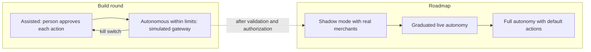
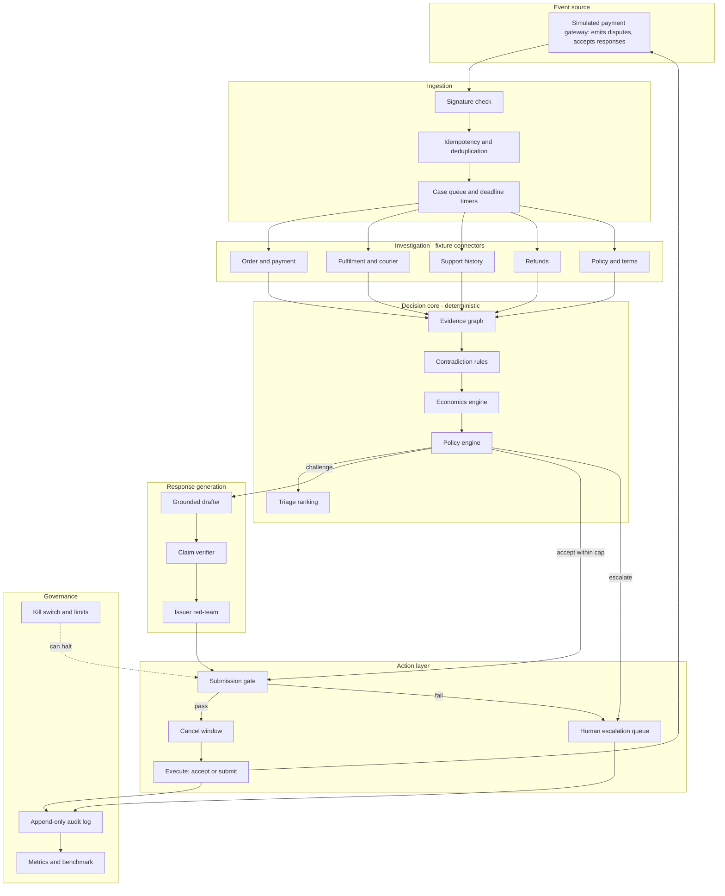
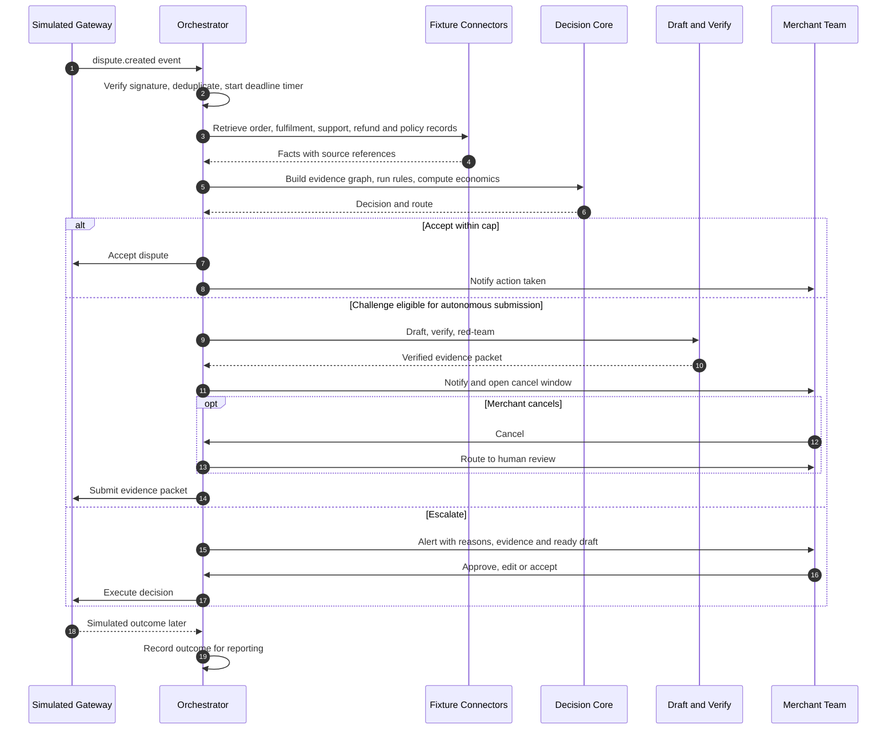
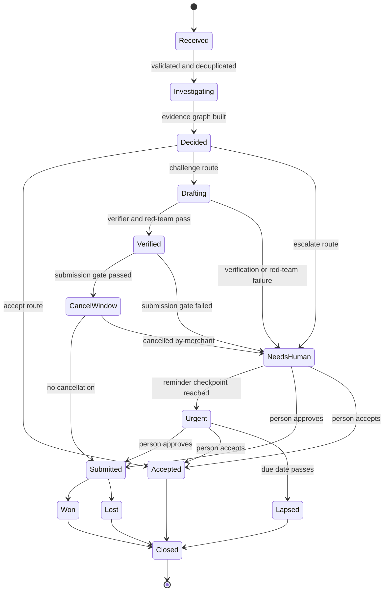
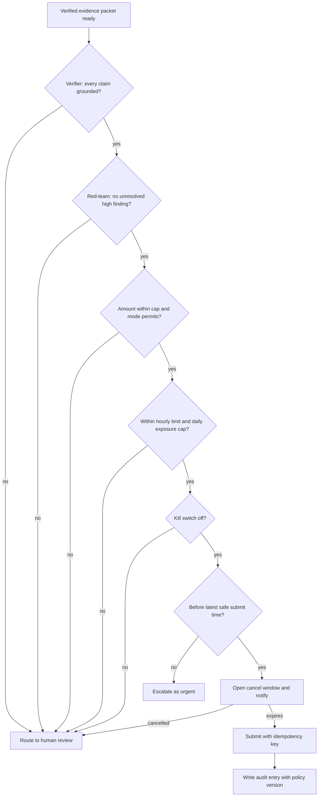

# ProofPilot: Controlled-Autonomy Dispute Response Agent

### Accept, Challenge or Escalate: Evidence-Grounded, Economics-Aware, Policy-Bounded

| | |
|---|---|
| **Document type** | Final product and technical specification (companion to the idea submission) |
| **Version** | 2.0 (supersedes the earlier "Autonomous Dispute Operations" draft and the "Zero-Touch" vision note) |
| **Date** | 20 October 2026 |
| **Audience** | Hackathon evaluators, the engineering team, prospective partners |
| **Prototype scope** | Synthetic data, a simulated payment gateway, fixture-based connectors |
| **Status of content** | Items marked **Build round** are in scope for the prototype. Items marked **Roadmap** are not claimed as working. |

---

## Table of Contents

1. [Executive Summary](#1-executive-summary)
2. [Problem and Users](#2-problem-and-users)
3. [Scope Decisions](#3-scope-decisions)
4. [Controlled Autonomy Model](#4-controlled-autonomy-model)
5. [System Architecture](#5-system-architecture)
6. [Case Lifecycle](#6-case-lifecycle)
7. [Decision Logic](#7-decision-logic)
8. [Grounded Response Generation](#8-grounded-response-generation)
9. [Submission Gate and Safety Controls](#9-submission-gate-and-safety-controls)
10. [Simulated Gateway and Fixtures](#10-simulated-gateway-and-fixtures)
11. [User Experience](#11-user-experience)
12. [Demonstration Plan](#12-demonstration-plan)
13. [Evaluation Plan](#13-evaluation-plan)
14. [Build Plan](#14-build-plan)
15. [Security, Privacy and Legal Position](#15-security-privacy-and-legal-position)
16. [Failure Modes and Mitigations](#16-failure-modes-and-mitigations)
17. [Claims Policy](#17-claims-policy)
18. [Roadmap Beyond the Prototype](#18-roadmap-beyond-the-prototype)
19. [Assumptions, Risks and Open Decisions](#19-assumptions-risks-and-open-decisions)
20. [Glossary](#20-glossary)
21. [Appendices](#21-appendices)

---

## 0. How This Document Maps to the Submission

Every statement in the idea submission is specified in this document. The table below shows where.

| Statement in the submission | Specified in |
|---|---|
| Problem: scattered evidence, uneconomic contests, unsupported claims | Section 2 |
| Collects order, delivery, support, refund and policy evidence into a timestamped Evidence Graph | Sections 5, 7.1, 10 |
| Detects contradictions and missing proof with deterministic rules | Section 7.1 |
| Estimates net value of contesting: (win likelihood × recoverable amount) − (handling cost + fees) | Section 7.2 |
| Decides Accept, Challenge or Escalate with plain-language reasons | Section 7.3 |
| Every drafted sentence cites an evidence ID; code verifier blocks unsupported claims; adversarial review | Section 8 |
| Acts or escalates according to the merchant's policy; every step is logged | Sections 4, 9 |
| Controlled autonomy table (accept, submit after cancel window, escalate) | Section 4.2 |
| Caps, exposure limits, cancel window, kill switch, deadline timers | Section 9 |
| Rules decide; the language model reads and writes only | Sections 5.1, 8 |
| Prototype runs against a simulated gateway with synthetic data | Section 10 |
| Ranks open disputes by value and deadline | Section 7.4 |
| Benchmark against "contest everything" and "concede everything" baselines | Section 13 |
| Beyond the prototype: live integrations, chat approvals, graduated autonomy | Section 18 |
| Measured results rather than projected savings | Sections 13, 17 |

---

## 1. Executive Summary

When a customer disputes a payment, the merchant has a short, fixed window to respond with evidence scattered across order, fulfilment, support, refund and policy systems. Manual handling is slow, and generic AI letter writers add a new risk: fluent text containing invented facts.

**ProofPilot is an agent that handles the dispute workflow end to end, not only the writing.** For each incoming dispute it collects evidence, builds a timestamped Evidence Graph, detects contradictions, calculates whether contesting is financially worthwhile, and decides **Accept, Challenge or Escalate** with stated reasons. For challenges it drafts a response in which every sentence cites evidence, verifies it in code, and reviews it adversarially. It then acts or escalates under a merchant-defined policy, recording every step.

The distinguishing principle is **controlled autonomy**: the agent handles routine work on its own, inside explicit limits, and stops when a case falls outside them.

| Layer | Who or what decides | Technique |
|---|---|---|
| Perception | Language model (assisted by validation) | Extract facts from documents |
| Judgement | Deterministic code | Contradiction rules, economics, policy routing |
| Expression | Language model (constrained) | Write sentences from verified facts |
| Assurance | Deterministic code plus adversarial review | Claim verifier, red-team, submission gate |
| Action | Gated code | Accept or submit within limits, otherwise escalate |

---

## 2. Problem and Users

### 2.1 Problem

| Problem | Consequence |
|---|---|
| Evidence is spread across several systems | Slow, error-prone assembly under deadline |
| Cases are contested without cost analysis | Effort and fees can exceed what is recoverable |
| Winnable cases are conceded | Proof exists but is not found or assembled in time |
| Responses contain unsupported or contradictory statements | A single inconsistency can sink a response |
| Generic AI drafting | Confident, fluent, and sometimes fabricated |

### 2.2 Users

| User | Need | How ProofPilot helps |
|---|---|---|
| Dispute analyst or finance executive at an e-commerce merchant | Respond correctly before the deadline with less manual work | Prepared decisions, verified drafts, exception-first queue |
| Operations or finance manager | Control risk and understand outcomes | Policy limits, kill switch, audit trail, reports |
| Customer who raised the dispute | A fair, timely resolution | Merchant errors are accepted quickly; contested replies rest on documented facts |
| Payment provider or bank reviewer | Clear, consistent evidence | Structured, source-cited responses |

The initial target is **small and mid-sized e-commerce merchants** with limited dispute-handling capacity.

---

## 3. Scope Decisions

These decisions remove ambiguity between earlier drafts.

| Decision | Choice | Rationale |
|---|---|---|
| Dispute reasons supported first | Product not received, duplicate charge, service not provided | Each has structured, demonstrable evidence |
| Data | Synthetic only, with PII masking | Safe, free, reproducible |
| Gateway | **Simulated gateway** that emits disputes and accepts responses | Gives the autonomous loop a real target without approvals or cost |
| Source systems | Fixture-backed connectors for orders, fulfilment and courier, support, refunds and policy text | Realistic structure without integration risk |
| Autonomy in the prototype | Assisted mode, and Autonomous-within-limits mode against the simulated gateway | Demonstrates automation while staying bounded |
| Live submission to real processors | Roadmap | Requires authorization and processor rules |
| Chat-based approvals (Slack or Teams) | Optional if time allows, otherwise Roadmap | Not needed to prove the core mechanism |
| Win likelihood | Labelled an **estimate** | Not calibrated without real outcomes |

---

## 4. Controlled Autonomy Model

### 4.1 Principles

| # | Principle | Meaning |
|---|---|---|
| P1 | Autonomy within boundaries | The agent acts only inside merchant-defined, versioned limits |
| P2 | Deterministic decisions | Accept, challenge and escalate are chosen by code, never by the language model |
| P3 | No evidence, no sentence | Every drafted claim cites evidence; a code verifier blocks unsupported ones |
| P4 | Fail safe | Uncertainty routes to a person, not to a guess |
| P5 | Reversible where possible | A cancel window precedes irreversible submission |
| P6 | Explainable | Every action records its reasons, evidence and policy version |
| P7 | Honest estimates | Probabilities are labelled estimates, not guarantees |

### 4.2 What runs automatically, within limits, or with a person

| Case | What ProofPilot does | Mode |
|---|---|---|
| Intake, evidence collection, contradiction checks, economics, drafting, verification, ranking, audit logging | Always automatic | Build round |
| Uneconomic or confirmed merchant-error case under the merchant's cap | Accepts automatically | Build round, simulated gateway |
| Well-evidenced case that passes verification and policy thresholds | Prepares the evidence packet and submits it automatically after a cancel window | Build round, simulated gateway |
| Contradictions, missing proof, failed verification, high value or deadline risk | Stops and escalates to a person with reasons and a ready draft | Build round |
| Live processor submission, real platform connectors, shadow mode, full autonomy | Not claimed | Roadmap |

### 4.3 Operating modes

| Mode | Behavior | Status |
|---|---|---|
| **Assisted** | Prepares everything; a person approves every action | Build round |
| **Autonomous within limits** | Executes policy-eligible actions; escalates the rest | Build round (simulated gateway) |
| **Shadow** | Recommends only, and compares with human decisions to build trust | Roadmap |
| **Full autonomy** | Also resolves exceptions by policy defaults after an SLA | Roadmap |



### 4.4 Hard stops (apply in every mode)

- A response is never submitted if the verifier rejects any claim in it.
- Nothing autonomous happens while the kill switch is on.
- Actions above the configured amount cap or exposure limits are not taken autonomously.
- A case with a high-severity contradiction is never submitted without a person.
- If a case cannot be completed safely before the latest safe submit time, it is escalated as urgent, and the outcome is recorded.

---

## 5. System Architecture



### 5.1 Component responsibilities

| Component | Responsibility | Language model used? |
|---|---|---|
| Ingestion | Verify event signatures, deduplicate, start deadline timers | No |
| Fixture connectors | Return structured records; unstructured text is passed to the extractor | Extraction only |
| Evidence graph | Timestamped facts linked to their sources | No |
| Contradiction rules | Detect inconsistencies and missing proof | No |
| Economics engine | Evidence strength, win-likelihood estimate, net expected value | No |
| Policy engine | Select Accept, Challenge or Escalate and the autonomy route | No |
| Triage ranking | Order open cases by value, deadline and effort | No |
| Grounded drafter | Write sentences from the fact sheet, each tagged with evidence IDs | Yes (writing) |
| Claim verifier | Reject unsupported sentences | No |
| Issuer red-team | List the likeliest reasons the response would fail | Yes (critique) |
| Submission gate and cancel window | Pre-flight checks and delay before irreversible action | No |
| Audit log | Record every step | No |

---

## 6. Case Lifecycle

### 6.1 Sequence



### 6.2 State machine



### 6.3 Deadline management

| Checkpoint | Timing (configurable) | Action |
|---|---|---|
| First reminder | 72 hours before due | Notify the exception owner |
| Second reminder | 24 hours before due | Notify the owner and backup |
| Latest safe submit time | Due date minus a safety buffer (default 12 hours) | No new autonomous submission starts after this point; case is escalated as urgent |
| Lapse | Due date passes | Recorded as a lapsed case and reported |

---

## 7. Decision Logic

### 7.1 Evidence Graph and contradiction rules

The Evidence Graph orders facts on a timeline and links each to its source record. Contradiction rules run on the graph and are individually unit-tested.

| Rule | Condition | Severity |
|---|---|---|
| C1 | Delivery recorded before dispatch | High |
| C2 | Delivery address differs from order address | High |
| C3 | Refund recorded but not linked to this transaction | Medium |
| C4 | Completion notice earlier than the stated service end | Medium |
| C5 | Duplicate charge claimed but no second settlement found | High |
| C6 | Evidence dated after the dispute due date | Low |
| M1 to M3 | Required evidence missing per the reason's playbook | Reported as missing proof |

Reason-code **playbooks** are JSON configuration listing each reason's required evidence, weights and known failure modes. Supported at first: product not received, duplicate charge, service not provided.

### 7.2 Economics

```
net_expected_value = (estimated_win_likelihood x recoverable_amount) - (handling_cost + response_fees)
```

| Quantity | Definition |
|---|---|
| Evidence strength | Sum of weights of required evidence that is present and not contradicted, divided by total weight |
| Estimated win likelihood | Evidence strength reduced by contradiction penalties, bounded between 0.02 and 0.95; shown as an **estimate** |
| Handling cost, response fees | Merchant-configured; demonstration values are illustrative defaults |

The interface shows every input, the formula and the result for each case.

### 7.3 Policy engine: decision order

Rules are evaluated top to bottom; the first match wins. Each outcome stores its reasons.

| Priority | Condition | Route |
|---|---|---|
| 1 | Kill switch on | Hold for a person; no autonomous action |
| 2 | Event already processed | Ignore |
| 3 | Confirmed merchant error (for example, verified duplicate charge) | Accept |
| 4 | Net expected value ≤ 0 and amount within the auto-accept cap | Accept |
| 5 | Any high-severity contradiction | Escalate |
| 6 | Not enough time before the latest safe submit time | Escalate as urgent |
| 7 | Evidence strength and win-likelihood estimate meet thresholds, amount within the auto-submit cap, verifier passes, no unresolved high red-team finding | Challenge |
| 8 | Anything else | Escalate |

In **Assisted mode** every route ends with a person's approval. In **Autonomous within limits** mode, routes 3, 4 and 7 execute without a person, subject to the submission gate (Section 9).

### 7.4 Deadline-aware triage

```
score = (max(net_expected_value, 0) / effort_hours) x urgency
urgency = 1.0 (over 72h left), 1.5 (24 to 72h), 2.0 (under 24h)
```

Escalated cases rank by `amount x urgency`. Cases past their latest safe submit time are pinned to the top with a warning. The score breakdown is shown so a reviewer can see why a case ranks where it does.

---

## 8. Grounded Response Generation

### 8.1 Pipeline

| Stage | Description |
|---|---|
| Fact sheet | The drafter receives only the verified facts (with IDs) and the decision |
| Drafting | The model writes sentences, each tagged with supporting evidence IDs, as structured output |
| Verification | Code checks every sentence (Section 8.2) |
| Red-team | A second pass lists the top three reasons the response might lose |
| Resolution | Code decides: patch once, add to the to-do list, or escalate |
| Fallback | If the model fails or returns invalid output after retries, a template drafter builds the same structure from facts |

### 8.2 Claim verifier checks

| Check | Rejects |
|---|---|
| Evidence present | A claim with no evidence ID |
| Evidence valid | An ID that does not exist |
| Value match | Any date, amount, order or tracking ID, or personal name that does not appear in the cited facts |
| Language | Absolute promises such as "guaranteed" |
| Boilerplate | Anything outside an approved whitelist that carries no evidence |

Rejected sentences are removed and turned into to-do items. The verifier is tested against adversarial inputs: a fabricated date, a fabricated tracking number, a false amount, and a citation to a nonexistent evidence ID. Success is stated as **zero unsupported claims on the defined test suite**, not as a universal guarantee.

### 8.3 Red-team

The red-team receives the draft, the facts, the contradictions and the playbook's failure modes. It returns up to three structured findings, each with a fix type: patch, need evidence, or escalate. Code, not the model, decides what happens next, with at most one patch iteration.

### 8.4 Untrusted content

Customer messages and external documents are treated as data. The model has no ability to call tools or trigger actions, outputs are schema-validated, and instructions embedded in evidence cannot change routing or policy.

---

## 9. Submission Gate and Safety Controls

Submitting evidence to a processor is often **final**: many accept evidence only once per dispute. The simulated gateway reproduces this constraint, so the gate treats submission as irreversible.



### 9.1 Control catalogue

| Control | Description | Risk addressed | Status |
|---|---|---|---|
| Claim verifier | Blocks unsupported claims | Fabricated content | Build round |
| Cancel window | Delay with a cancel action before submission | Mistaken submissions | Build round |
| Amount caps | Separate caps for auto-accept and auto-submit | Large unintended actions | Build round |
| Exposure limits | Hourly action limit and daily value cap | Runaway behavior | Build round |
| Kill switch | One control that halts all autonomous actions | Incidents, misconfiguration | Build round |
| Deadline timers | Reminders and latest safe submit time | Missed deadlines | Build round |
| Idempotency keys | One action per case and event | Duplicate actions | Build round |
| Policy versioning | Each action records the policy in force | Accountability | Build round |
| Append-only audit table | Chronological record of events and actors | Accountability | Build round |
| Shadow mode | Compare recommendations with human decisions | Unproven decision quality | Roadmap |
| Circuit breaker | Pause automation when override or failure rates rise | Silent quality drift | Roadmap |
| Hash-chained audit log | Tamper-evident record | Integrity | Roadmap |

---

## 10. Simulated Gateway and Fixtures

The simulated gateway is a small service that stands in for a payment processor. It lets the prototype run a genuine event-driven loop at no cost and without approvals, and it enables **failure injection**.

### 10.1 Behavior

| Capability | Detail |
|---|---|
| Dispute events | Emits `dispute.created` with reason, amount, currency and due date, on demand or on a schedule |
| Signed webhooks | Sends events with a signature the receiver verifies |
| Accept | Endpoint that records acceptance |
| Evidence submission | **One-shot**: a second submission for the same dispute is refused |
| Outcome | Returns a simulated win or loss later, drawn from the hidden ground truth of each synthetic case |
| Failure injection | Duplicate events, delayed events, server errors on submit, connector timeouts |

### 10.2 Fixture data

| Source | Contents |
|---|---|
| Order and payment | Order details, amounts, settlement records |
| Fulfilment and courier | Dispatch and tracking events, delivery confirmations |
| Support history | Customer conversation transcripts |
| Refunds | Refund records, linked or unlinked to transactions |
| Policy and terms | Versioned policy text accepted at checkout |

Each synthetic case carries **ground-truth labels** (expected facts, seeded contradictions, expected recommendation) used only for evaluation.

---

## 11. User Experience

| Screen | Purpose | Key elements |
|---|---|---|
| Live queue | See disputes arrive and be handled | Ranked cases, status, amount, time left, route taken, "why this rank" expander |
| Case view | Understand and, if needed, act | Evidence timeline with contradictions highlighted, decision panel, draft with evidence chips, to-do list, red-team findings, audit trail |
| Policy and controls | Set limits | Caps, thresholds, cancel window, mode, **kill switch** |
| Benchmark | Show evidence of effectiveness | Comparison against baselines, contradiction metrics, verifier results |

### 11.1 Decision explanation panel

Every case shows which rule fired, which evidence and costs drove the result, the formula with its inputs, and the reasons in plain language.

### 11.2 Notifications

The prototype provides an in-app alert feed with actions: cancel, approve, accept. Chat-based approvals (Slack or Teams) are optional if time allows.

```text
ProofPilot | Exception | Dispute D-1043 | INR 9,000
Reason: product not received
Flag: HIGH - delivery scan (6 Oct) precedes dispatch record (7 Oct)
Evidence strength: 0.58 (estimate)   Net expected value: +INR 3,550 (illustrative)
Missing: signed delivery confirmation
Due: 2026-10-24 18:00   Latest safe submit: 2026-10-24 06:00
Draft: ready, all claims verified     Red-team: 1 open finding

[ Approve and submit ]  [ Edit ]  [ Accept dispute ]
```

---

## 12. Demonstration Plan

A short live run on the simulated gateway, using three contrasting disputes. All amounts, costs and fees are **illustrative**.

| Case | Scenario | Expected route | What it shows |
|---|---|---|---|
| A | ₹650 duplicate charge, records confirm the duplicate | **Accept**, automatically within the cap | Economics and merchant-error rule |
| B | ₹18,400 service not provided; usage logs present; completion email dated before service end | **Challenge**, draft cites the usage log, passes verification, submitted after the cancel window | Grounded drafting and the red-team catching the email timing |
| C | ₹9,000 product not received; courier scan precedes dispatch | **Escalate** with the contradiction highlighted | Refusing to guess |

Worked numbers (illustrative): Case B, estimated win likelihood 0.82, handling cost ₹400, fees ₹1,000 gives a net expected value of 0.82 × 18,400 − 1,400 = ₹13,688. Case C, estimate 0.55, same costs gives ₹3,550, yet it escalates because rule 5 (high-severity contradiction) precedes the economic rules.

| Moment | Action | Demonstrates |
|---|---|---|
| Fabrication test | Inject a fabricated tracking number into a draft | The verifier removes the sentence and creates a to-do |
| Kill switch | Press the kill switch, then emit another dispute | The case routes to a person, not an autonomous action |
| Cancel window | Cancel a pending submission | Reversibility before the irreversible step |
| Duplicate event | Replay the same webhook | One action only (idempotency) |

---

## 13. Evaluation Plan

### 13.1 Design

| Element | Specification |
|---|---|
| Dataset | About 50 synthetic disputes over the three supported reasons, generated with a fixed random seed |
| Labels | Expected facts, seeded contradictions, expected recommendation, and a hidden outcome |
| Split | A held-out 20 percent that is not used while tuning rules or prompts |
| Baselines | "Contest everything" and "Concede everything" |
| Net result per case | Contested: (won ? amount : 0) − handling cost − fees. Accepted: 0 |
| Outcome simulation | Drawn from the hidden ground truth and seeded noise, **independent of the engine's own win estimate**, so the result is not circular |
| Thresholds | Pass criteria are fixed **before** the first benchmark run |

### 13.2 Metrics

| Metric | Definition | Proposed pass criterion (fix before running) |
|---|---|---|
| Extraction accuracy | Correct extracted values ÷ labelled values | Report; set threshold from the first dry run |
| Contradiction recall and precision | Seeded contradictions found; false alarms | Report both, with a minimum recall set in advance |
| Unsupported claims | Dates, amounts or IDs in verified drafts not found in evidence | 0 on the defined suite |
| Unsafe autonomous actions | Autonomous submissions on cases labelled "must escalate" | 0 |
| Net result | Total across cases versus both baselines | Higher than both baselines |
| Decision agreement | Route matches the expected recommendation | Report |
| Failure handling | Duplicate events, model outage, connector failure, kill switch, cancelled hold | All handled as specified |
| Latency | Event received to routed decision | Report the median |

### 13.3 Interpretation

Results come from synthetic data and a simulated outcome model. They demonstrate that the design behaves as specified under tested conditions. They are not evidence of real-world performance or of financial recovery.

---

## 14. Build Plan

Assumed: a 5-day build round and a team of three to four. Adjust to the actual timeline.

### 14.1 Day-by-day

| Day | Focus | Exit criterion |
|---|---|---|
| 1 | Contracts, playbooks, synthetic data generator with labels, simulated gateway skeleton | 50 cases and labels exist; contracts frozen |
| 2 | Extraction with schema validation, evidence graph, contradiction rules | Contradiction recall and extraction accuracy measured |
| 3 | Economics, policy engine, grounded drafter, verifier, template fallback | Zero unsupported claims across all drafts |
| 4 | Red-team, triage, submission gate, cancel window, kill switch, audit log, live queue and case view | One case runs end to end through the interface |
| 5 | Benchmark, failure injection, cached demo outputs, documentation, rehearsal | Three-case demo runs reliably |

### 14.2 Technology

| Layer | Choice |
|---|---|
| Backend | Python, FastAPI, Pydantic, SQLite |
| Frontend | React with Vite, or Streamlit if frontend capacity is limited |
| Model | Open-weights model run locally; mock client for tests; schema validation with retry then fallback |
| Cost | Free and open source throughout |

### 14.3 Cut order if time is short

1. Chat-based notifications
2. Red-team auto-patch (keep the findings display)
3. Hourly and daily exposure limits (keep per-action caps)
4. A second reason category (keep two of the three)

Never cut: the evidence graph, contradiction rules, economics and policy engine, verifier with its adversarial tests, the cancel window and kill switch, the audit log, and the benchmark.

---

## 15. Security, Privacy and Legal Position

| Area | Requirement |
|---|---|
| Event authenticity | Verify signatures; reject unsigned or replayed events |
| Data | Synthetic only in the prototype; mask personal identifiers in logs and prompts |
| Secrets | Never in source control; provide an example environment file only |
| Cardholder data | Not stored; out of scope for the prototype |
| Model data handling | Local model in the prototype; real merchant data would require a self-hosted or contractually protected model |
| Tenant isolation | Required in any production design |
| Regulation | Assess payment-industry security standards and data-protection law (for example India's DPDP Act and GDPR) with qualified advisers before real data is used |

**Legal position.** Whether an agent may submit responses on a merchant's behalf depends on the merchant's agreement with its processor, the processor's and networks' rules, and applicable law. This document is not legal advice. The design relies on explicit, recorded merchant authorization through a versioned policy, an audit trail, and merchant control of limits and the kill switch. Before any production use, the position must be confirmed with counsel and the relevant processor.

---

## 16. Failure Modes and Mitigations

| Failure mode | Effect | Mitigation |
|---|---|---|
| Duplicate or replayed event | Double action | Idempotency keys and deduplication |
| Missed event | Late detection | Roadmap: periodic reconciliation of open disputes with the gateway |
| Connector failure | Missing evidence | Retry; mark facts unavailable; escalate if material |
| Model outage or invalid output | No draft | Schema retry, then template fallback |
| Fabricated detail in a draft | Incorrect submission | Verifier blocks; sentence becomes a to-do |
| Conflicting courier and order data | Weak or wrong position | Contradiction rules; escalate on high severity |
| Policy misconfiguration | Unwanted autonomous actions | Validation, caps, cancel window, kill switch |
| Deadline nearly expired | Late or no response | Latest safe submit time, reminders, urgent escalation |
| Adversarial text in evidence | Manipulated output | Untrusted-content handling; the model has no tool access |
| Unattended escalation | Case lapses | Reminders; lapses are recorded and reported |

---

## 17. Claims Policy

| We say | We do not say |
|---|---|
| The agent handles routine disputes within merchant-defined limits and escalates the rest | It is fully unattended or needs no human |
| A code verifier blocks unsupported claims, and we test it against fabricated facts | It is hallucination-free or never wrong |
| The win likelihood is an estimate based on evidence completeness and contradictions | It is a calibrated probability of winning |
| The prototype runs on a simulated gateway with synthetic data | It is integrated with real processors or platforms |
| We will report measured benchmark results | It saves a specific number of hours or an automation percentage |
| Live submission and integrations are roadmap items needing authorization | It is legally cleared for autonomous submission |

---

## 18. Roadmap Beyond the Prototype

| Phase | Scope |
|---|---|
| 1. Prototype (this build round) | Everything marked Build round |
| 2. Shadow pilot | Run beside real teams using sandbox or exported data; measure agreement and overrides |
| 3. Live integrations | One payment-gateway sandbox, then commerce-platform and courier connectors, subject to API availability, terms and merchant authorization |
| 4. Chat approvals and graduated autonomy | Slack or Teams actions; shadow to autonomous progression based on measured override rates |
| 5. Learning and insight | Outcome-based calibration of win estimates; root-cause analytics (for example disputes clustering by courier or region); multilingual drafts |
| 6. Distribution and enterprise | Marketplace apps and a headless worker for custom systems |

---

## 19. Assumptions, Risks and Open Decisions

### 19.1 Assumptions

- A 5-day build round and a team of three to four.
- The simulated gateway and fixtures are acceptable for demonstrating the workflow.
- A local open-weights model is available on the team's machines.

### 19.2 Risks

| Risk | Rating | Response |
|---|---|---|
| Evaluators expect live integrations | Medium | State clearly that the prototype uses a simulated gateway; show the connector interface and the roadmap |
| Evaluators expect only human-approved actions | Low | Assisted mode is built; autonomy is opt-in and bounded |
| Build-round time constraints | Medium | Strict scope and cut order |
| Small model produces poor drafts | Medium | Template fallback; verifier ensures safety even when quality is low |
| Benchmark seen as circular | Medium | Outcomes drawn from hidden ground truth, independent of the engine's estimate |

### 19.3 Open decisions

1. Confirm in the official track brief whether autonomous action is expected or permitted.
2. Confirm whether a real sandbox connector is wanted after the core works.
3. Decide whether Slack or Teams approvals are in scope.
4. Fix benchmark pass thresholds before the first run.

---

## 20. Glossary

| Term | Meaning |
|---|---|
| Dispute / chargeback | A customer's request, via their bank, to reverse a payment |
| Evidence packet | The statements and documents submitted to contest a dispute |
| Evidence graph | Timeline of facts linked to their sources |
| Net expected value | Estimated recovery minus the cost of contesting |
| Claim verifier | Code that rejects response sentences not supported by evidence |
| Cancel window | Delay before submission during which a person can cancel |
| Kill switch | Control that immediately halts autonomous actions |
| Idempotency key | Identifier ensuring an action is applied once even if repeated |
| Simulated gateway | A stand-in payment processor used by the prototype |
| Shadow mode | Operation in which the system recommends but does not act |

---

## 21. Appendices

### 21.1 Sample policy

```yaml
policy_version: "2026-10-20.1"
currency: INR
mode: autonomous_within_limits     # assisted | autonomous_within_limits

auto_accept:
  when: "confirmed_merchant_error or net_ev <= 0"
  max_amount: 5000

auto_submit:
  min_evidence_strength: 0.85
  min_p_win_estimate: 0.80          # an estimate, not a guarantee
  max_amount: 25000
  require: [verifier_pass, no_high_contradiction, redteam_clear]
  cancel_window_minutes: 30

escalate:
  amount_above: 25000
  any_high_contradiction: true
  notify: ["in_app_feed"]

deadlines:
  safety_buffer_hours: 12
  reminders_hours_before_due: [72, 24]

costs:                              # illustrative defaults
  handling_cost: 400
  response_fee: 1000

limits:
  max_auto_actions_per_hour: 20
  daily_exposure_cap: 200000

kill_switch: false
```

### 21.2 Data contracts

| Contract | Key fields |
|---|---|
| `DisputeEvent` | event_id, dispute_id, reason, amount, currency, due_by, received_at |
| `Fact` | id, type, ts, text, fields, source, confidence |
| `Contradiction` | id, rule_id, severity, fact_ids, explanation |
| `Decision` | route, recommendation, reasons, evidence_strength, p_win_estimate, economics, missing_evidence, policy_version |
| `DraftSentence` | text, evidence_ids, kind (claim or boilerplate) |
| `GroundingReport` | kept, removed (with reasons), todos |
| `RedTeamFinding` | weakness, why_it_loses, fix_type, related_fact_ids |
| `ActionRecord` | case_id, action, idempotency_key, actor, policy_version, timestamp, result |
| `AuditEntry` | sequence_number, case_id, event, details, timestamp |

### 21.3 Simulated gateway interface

| Endpoint | Purpose |
|---|---|
| `POST /gateway/disputes` | Create a simulated dispute and emit its event |
| `POST /gateway/scenarios/run` | Emit a batch of disputes from the synthetic set |
| `GET /gateway/disputes/{id}` | Read status and due date |
| `POST /gateway/disputes/{id}/accept` | Record acceptance |
| `POST /gateway/disputes/{id}/evidence` | Submit the evidence packet (one-shot; a second call returns a conflict) |
| `POST /gateway/failures` | Turn on failure injection: duplicate events, delayed events, submit errors, connector timeouts |
| `POST /webhooks/gateway` (on ProofPilot) | Receive signed dispute events |

### 21.4 Idempotency and ordering

- The idempotency key for each action is `case_id + action_type + packet_hash`.
- Webhook handlers acknowledge quickly and enqueue work; processing is asynchronous.
- Replayed events are recognized by `event_id` and ignored.

---

*End of document.*
