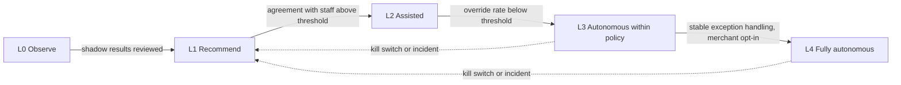
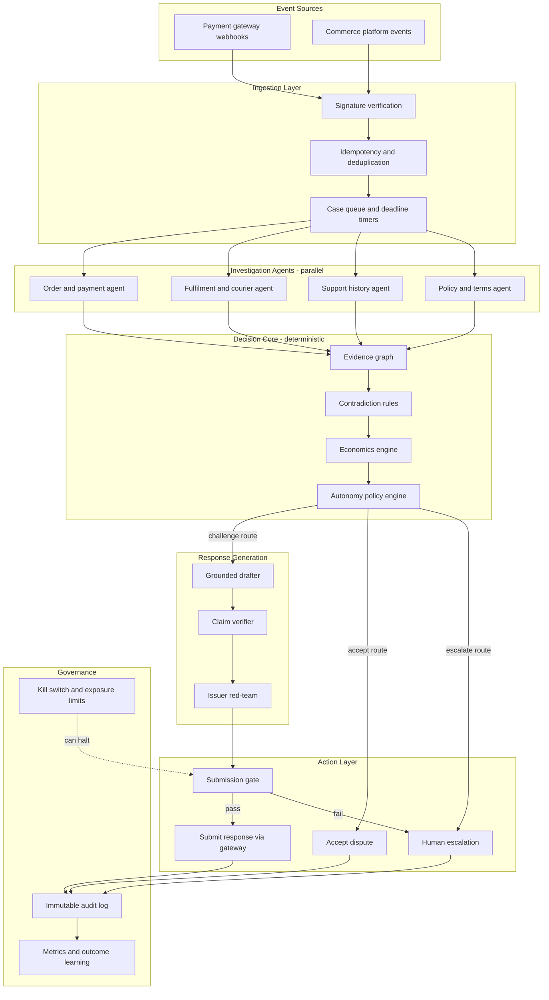
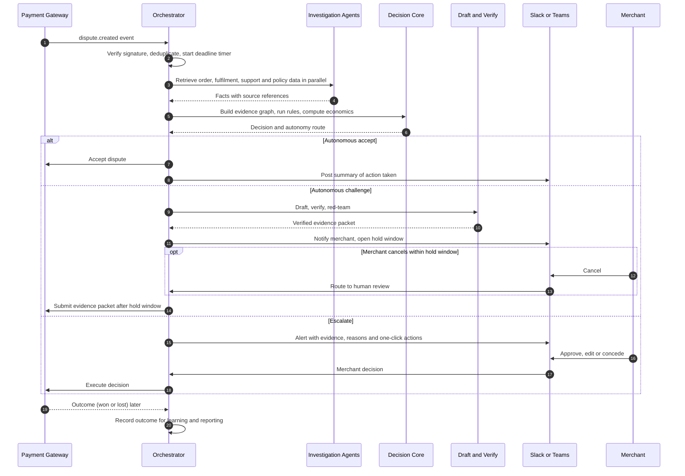
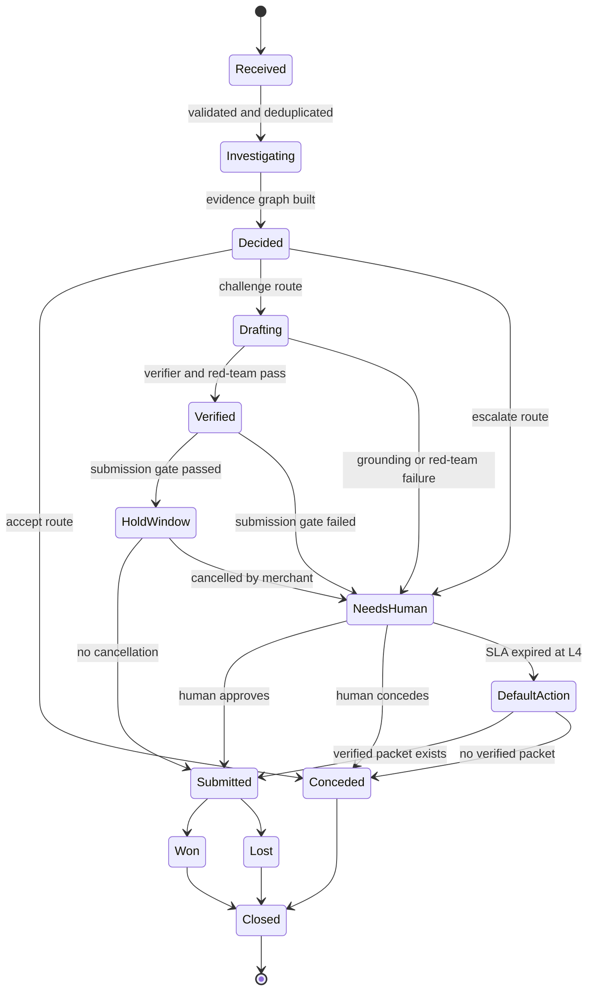
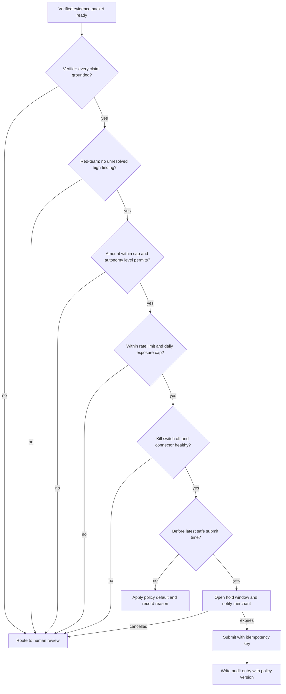
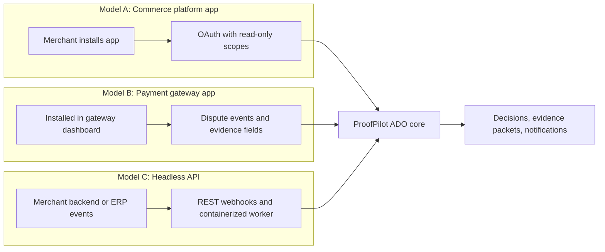

# ProofPilot Autonomous Dispute Operations (ADO)

### A Zero-Touch, Evidence-Grounded Platform for Payment Dispute Resolution

| | |
|---|---|
| **Document type** | Product and technical specification |
| **Version** | 1.0 (draft for team review) |
| **Date** | 20 October 2026 |
| **Audience** | Hackathon evaluators, engineering team, prospective merchant and platform partners |
| **Status** | Proposal for the building round; items marked *Future* are outside the hackathon scope |

---

## Table of Contents

1. [Executive Summary](#1-executive-summary)
2. [Problem Statement and Opportunity](#2-problem-statement-and-opportunity)
3. [Vision and Design Principles](#3-vision-and-design-principles)
4. [Defining "Totally Autonomous": The Autonomy Ladder](#4-defining-totally-autonomous-the-autonomy-ladder)
5. [System Architecture](#5-system-architecture)
6. [End-to-End Case Lifecycle](#6-end-to-end-case-lifecycle)
7. [The Autonomous Policy Engine](#7-the-autonomous-policy-engine)
8. [Submission Gate and Safety Controls](#8-submission-gate-and-safety-controls)
9. [Integration Strategy](#9-integration-strategy)
10. [Human-on-the-Loop Experience](#10-human-on-the-loop-experience)
11. [AI Responsibilities and Boundaries](#11-ai-responsibilities-and-boundaries)
12. [Security, Privacy and Compliance](#12-security-privacy-and-compliance)
13. [Legal and Liability Considerations](#13-legal-and-liability-considerations)
14. [Failure Modes and Mitigations](#14-failure-modes-and-mitigations)
15. [Metrics and Business Case](#15-metrics-and-business-case)
16. [Delivery Roadmap](#16-delivery-roadmap)
17. [Assumptions, Risks and Open Questions](#17-assumptions-risks-and-open-questions)
18. [Glossary](#18-glossary)
19. [Appendix: Reference Artifacts](#19-appendix-reference-artifacts)

---

## 1. Executive Summary

Payment disputes (chargebacks) are time-bound, evidence-heavy and financially significant, yet most merchants handle them manually. Staff copy tracking numbers between systems, write replies under deadline pressure, and often contest disputes that cost more to fight than they could recover, while conceding others that were winnable.

**ProofPilot Autonomous Dispute Operations (ADO)** extends the ProofPilot core (Evidence Graph, Economics Engine, Claim-Grounded Drafting, Issuer Red-Team) into a **background agent that handles the full dispute lifecycle without a dashboard login**. It listens for dispute events, collects evidence from connected systems, decides whether to accept or contest, produces a verified response and submits it, all within limits the merchant defines in advance.

The central design choice is **autonomy under delegated authority**. The merchant authorizes ProofPilot to act through a versioned, auditable policy. ProofPilot acts within that policy, stops when it falls outside it, and can be paused instantly. Decisions are made by deterministic, testable code; the language model is confined to reading documents and writing prose from verified facts.

| Dimension | Today (manual) | ProofPilot ADO |
|---|---|---|
| Trigger | Staff notice an email or dashboard alert | Webhook fires within seconds |
| Evidence collection | Manual lookups across several systems | Parallel automated retrieval |
| Contest-or-concede decision | Judgement, often without cost analysis | Rule-based net expected value with stated reasons |
| Response writing | Free-form, error-prone | Every sentence traceable to evidence, machine-verified |
| Submission | Manual upload before deadline | Automatic, gated, deadline-aware |
| Human involvement | Every case | Exceptions and oversight only |
| Record keeping | Scattered notes | Immutable audit trail with policy version |

---

## 2. Problem Statement and Opportunity

### 2.1 The problem

| Problem | Consequence |
|---|---|
| **Contesting uneconomic cases** | Effort and processor fees can exceed the amount recoverable |
| **Conceding winnable cases** | Proof exists but is scattered across order, courier, support and policy systems |
| **Inconsistent or weak responses** | A single contradiction or missing document can sink a response |
| **Hard deadlines, small teams** | Missed windows mean automatic loss |
| **Generic AI drafting** | Fluent text can contain invented facts, which is unacceptable in a financial dispute |

### 2.2 Illustrative effort model

The figures below are **illustrative assumptions for explanation, not measured results**. They should be replaced with merchant data during pilots.

| Parameter | Assumed value |
|---|---|
| Disputes per month | 100 |
| Manual handling time per dispute | 45 minutes |
| Fully loaded staff cost | ₹400 per hour |
| Manual effort per month | 100 × 45 min = **75 hours (₹30,000)** |
| Share resolved with no human touch (target hypothesis) | 80% |
| Exception cases reviewed | 20, at about 15 minutes each |
| Effort with ADO | **5 hours (₹2,000)** |
| Estimated labor saving | **70 hours (₹28,000) per month** |

Direct savings from avoided response fees and improved recovery are additional and depend on each processor's fee schedule, which must be confirmed with the merchant's processor.

### 2.3 Who is affected

| Stakeholder | Impact |
|---|---|
| Merchants (SMB to enterprise) | Lower operating cost, better recovery, fewer missed deadlines |
| Dispute and finance teams | Work shifts from data entry to exception review |
| Customers | Faster refunds when the merchant is at fault; replies grounded in documented facts |
| Payment providers and banks | Cleaner, evidence-backed submissions that are easier to review |

---

## 3. Vision and Design Principles

**Vision:** the merchant opens a dashboard only when something is broken.

| # | Principle | Practical meaning |
|---|---|---|
| P1 | **Delegated, bounded authority** | ProofPilot acts only inside a merchant-signed, versioned policy |
| P2 | **Deterministic decisions** | Accept, contest and escalate are made by code, never by the language model |
| P3 | **No evidence, no sentence** | Every claim in a response cites evidence and is machine-verified |
| P4 | **Fail safe** | Any uncertainty routes to a defined safe action, not to a guess |
| P5 | **Reversible where possible** | A hold window lets the merchant cancel before irreversible submission |
| P6 | **Full explainability** | Each action records its reasons, evidence, policy version and actor |
| P7 | **Earned trust** | Autonomy is switched on progressively, starting with shadow mode |
| P8 | **Honest estimates** | Probabilities are labelled estimates, never guarantees |

---

## 4. Defining "Totally Autonomous": The Autonomy Ladder

"Totally autonomous" is implemented as the highest rung of a ladder, not as an absence of controls. Each merchant chooses a level, and can move up or down at any time.

| Level | Name | Behavior | Human role |
|---|---|---|---|
| **L0** | Observe | Ingests disputes, builds evidence, logs what it would do | Review reports |
| **L1** | Recommend | Presents a decision and reasons for each case | Decides and submits |
| **L2** | Assisted | Prepares a verified packet; merchant approves with one click | Approves each case |
| **L3** | Autonomous within policy | Auto-accepts and auto-submits cases that meet policy; routes the rest to humans | Handles exceptions |
| **L4** | Fully autonomous | As L3, and also resolves exceptions itself by policy defaults after an SLA expires | Supervises through digests and the kill switch |

**Hard stops apply at every level**, including L4:

- A response is never submitted if the verifier rejects any claim in it.
- Nothing is submitted when the kill switch is on or a connector is unhealthy.
- Actions above configured exposure limits are not taken autonomously.
- If a case cannot be completed safely before the deadline, the policy default (concede, or submit the verified portion) is applied, and the reason is recorded.



---

## 5. System Architecture

ADO is organized into layers with a strict separation between **perception** (AI-assisted), **decision** (deterministic) and **action** (gated).



### 5.1 Component responsibilities

| Component | Responsibility | AI used? |
|---|---|---|
| Ingestion | Verify webhook signatures, deduplicate events, start deadline timers | No |
| Investigation agents | Retrieve records from connected systems in parallel; extract facts from unstructured text | Extraction only |
| Evidence graph | Build a timestamped timeline of facts with source references | No |
| Contradiction rules | Detect inconsistencies (for example delivery recorded before dispatch) | No |
| Economics engine | Compute evidence strength, estimated win likelihood and net expected value | No |
| Autonomy policy engine | Match the case to the merchant's policy and select the route | No |
| Grounded drafter | Write response sentences from the fact sheet, each tagged with evidence IDs | Yes (writing) |
| Claim verifier | Reject any sentence whose evidence, dates, amounts or IDs are unsupported | No |
| Issuer red-team | Identify the likeliest reasons the response would fail | Yes (critique) |
| Submission gate | Run pre-flight checks and apply the hold window | No |
| Audit log | Record every step with timestamps, reasons and policy version | No |

---

## 6. End-to-End Case Lifecycle

### 6.1 Sequence of operation



### 6.2 Case state machine



### 6.3 Deadline management

Every case carries a gateway-supplied due date. ProofPilot derives internal checkpoints from it.

| Checkpoint | Timing (configurable) | Action |
|---|---|---|
| Latest safe submit time | Due date minus a safety buffer (default 12 hours) | After this point no new autonomous submission is started |
| First reminder | 72 hours before due | Notify the exception owner |
| Second reminder | 24 hours before due | Notify the owner and the backup owner |
| Default action | Latest safe submit time, if still unresolved | L4 applies the policy default; L3 escalates as urgent |

---

## 7. The Autonomous Policy Engine

### 7.1 Decision order

Rules are evaluated from top to bottom and the **first match wins**. Each outcome records its reasons.

| Priority | Condition | Route | Autonomous at L3 and above |
|---|---|---|---|
| 1 | Kill switch is on, or a required connector is unhealthy | Hold for human | Yes (safe stop) |
| 2 | Event already processed (duplicate) | Ignore | Yes |
| 3 | Confirmed merchant error (for example, verified duplicate charge or refund already issued) | Accept | Yes |
| 4 | Net expected value ≤ 0 and amount within the auto-accept cap | Accept | Yes |
| 5 | Any high-severity contradiction in the evidence | Escalate | Human at L3; policy default after SLA at L4 |
| 6 | Evidence strength and estimated win likelihood meet thresholds, amount within the auto-submit cap, verifier passes, red-team has no unresolved high finding | Challenge and submit | Yes, after hold window |
| 7 | Anything else | Escalate | Human at L3; policy default after SLA at L4 |

### 7.2 Economics

```
net_expected_value = (estimated_win_likelihood x recoverable_amount) - (handling_cost + response_fees)
```

- `estimated_win_likelihood` is derived from the completeness and consistency of evidence against the reason-code playbook, reduced by contradiction penalties. It is displayed as an **estimate**.
- Cost parameters are supplied by the merchant. Response fees depend on the processor and must be configured from the processor's published fee schedule.
- Once outcomes accumulate, the estimate is calibrated against actual results.

### 7.3 Merchant policy parameters

| Parameter | Purpose | Example default |
|---|---|---|
| `autonomy_level` | Chooses L0 to L4 | 3 |
| `auto_accept.max_amount` | Largest amount that may be accepted autonomously | ₹5,000 |
| `auto_submit.max_amount` | Largest amount that may be submitted autonomously | ₹25,000 |
| `auto_submit.min_evidence_strength` | Minimum evidence completeness | 0.85 |
| `auto_submit.min_p_win_estimate` | Minimum estimated win likelihood | 0.80 |
| `hold_window_minutes` | Time to cancel before submission | 30 |
| `exception_sla_hours` | Time allowed for human review of exceptions | 24 |
| `default_on_sla_expiry` | Action when the SLA lapses at L4 | submit if verified, else accept |
| `max_auto_actions_per_hour` | Rate limit | 20 |
| `daily_exposure_cap` | Total value that may be actioned autonomously per day | ₹2,00,000 |
| `kill_switch` | Immediately halts autonomous actions | off |

A complete sample policy file is provided in the [Appendix](#191-sample-autonomy-policy).

---

## 8. Submission Gate and Safety Controls

Submitting evidence to a gateway is frequently **final**: many processors permit evidence to be submitted only once per dispute. The submission gate therefore treats submission as irreversible and applies every check below before acting.



### 8.1 Control catalogue

| Control | Description | Risk addressed |
|---|---|---|
| Shadow mode | Runs alongside staff for a set number of cases; compares ProofPilot's decision with the human's | Unproven decision quality |
| Claim verifier | Rejects unsupported dates, amounts, IDs and names; removes ungrounded sentences | Fabricated content |
| Hold window | Delay with a cancel action before irreversible submission | Mistaken submissions |
| Idempotency keys | One action per case and event, safe under retries | Duplicate submissions |
| Exposure limits | Per-hour action count and daily value cap | Runaway behavior |
| Kill switch | One control that halts all autonomous actions per merchant | Incidents, misconfiguration |
| Policy versioning | Each action stores the policy hash in force | Auditability, disputes about authority |
| Circuit breaker | Pauses automation when override or failure rates exceed a threshold | Silent quality drift |
| Separation of duties | The language model has no tool access and cannot trigger actions | Prompt injection |
| Immutable audit log | Append-only record of events, reasons and actors | Accountability |

### 8.2 Trust graduation

| Stage | Entry criterion | Evidence of readiness |
|---|---|---|
| Shadow (L0 to L1) | Merchant connects data sources | Minimum case count processed |
| Assisted (L2) | Agreement rate with staff decisions above merchant threshold | Agreement report |
| Autonomous (L3) | Override rate of approved packets below threshold | Override report |
| Fully autonomous (L4) | Stable exception handling; explicit merchant opt-in recorded | Signed policy acknowledgement |

---

## 9. Integration Strategy

Three distribution models allow ProofPilot to operate on different platforms without the merchant building anything. **Availability of each API, its terms of use and the required merchant authorization must be confirmed before implementation.**



| Model | Description | Primary users | Stage |
|---|---|---|---|
| **A. Commerce platform app** | One-click install from an app marketplace; read access to orders, customers and fulfilments | Small and mid-size merchants | Future |
| **B. Payment gateway app** | Embedded in the gateway dashboard; pre-fills dispute response fields | Merchants already on that gateway | Future |
| **C. Headless API or worker** | Container or serverless worker that consumes merchant events and returns verdicts via webhooks | Enterprise with custom systems | Future |
| **Prototype connectors** | Sandbox or test-mode connectors and fixture-based mocks | Hackathon demonstration | Build round |

### 9.1 Data sources and connectors

| Source | Data retrieved | Direction | Build-round approach |
|---|---|---|---|
| Payment gateway | Dispute events, reason code, amount, due date; evidence submission | Read and write | Test-mode webhooks and events |
| Commerce platform | Order, customer, address, fulfilment records | Read-only | Development store or fixtures |
| Courier or logistics provider | Tracking events, delivery confirmation, signature or photo where available | Read-only | Mock connector with realistic fixtures |
| Support desk | Customer conversations and refund notes | Read-only | Fixture transcripts |
| Terms and policy store | Policy text accepted at checkout | Read-only | Versioned markdown files |
| Chat tools (Slack or Teams) | Alerts and one-click actions | Read and write | Free workspace and incoming interactive messages |
| ERP or custom systems | Order events | Read-only | Future |

### 9.2 Principle for network submissions

Card-network dispute systems are generally reached **through the acquirer or payment processor** rather than directly by the merchant. ADO therefore submits through the gateway's evidence-submission interface and does not assume direct access to network portals.

---

## 10. Human-on-the-Loop Experience

Merchants interact through the channels they already use. The default interface is a chat message with explicit actions; the web dashboard becomes a reporting and configuration surface.

### 10.1 Notification types

| Type | Trigger | Content | Actions |
|---|---|---|---|
| Action taken | Autonomous accept or submit completed | Case, amount, decision, reasons, evidence count | View audit entry |
| Hold-window notice | Challenge about to be submitted | Summary of the packet and time remaining | Cancel, edit, submit now |
| Exception alert | Escalation required | Contradictions, missing evidence, deadline | Approve, edit, concede |
| Urgent deadline | Checkpoint reached with no decision | Time remaining and default action | Decide now |
| Daily digest | End of day | Counts, value recovered, overrides, incidents | None |

### 10.2 Example exception alert

```text
ProofPilot | Exception | Dispute ORD-9921 | INR 38,000
Reason: product not received
Evidence strength: 0.62 (estimate)       Net expected value: +INR 19,400
Flag: HIGH - delivery scan (6 Oct) precedes dispatch record (7 Oct)
Missing: signed delivery confirmation
Due: 2026-10-24 18:00   Latest safe submit: 2026-10-24 06:00
Draft status: grounded (all claims verified), red-team: 1 open finding

[ Approve and submit ]  [ Edit in portal ]  [ Concede ]
```

---

## 11. AI Responsibilities and Boundaries

The language model is used only where it adds value and where its output can be verified.

| Task | Method | Model's role | Safeguard |
|---|---|---|---|
| Extract facts from documents and chats | Schema-constrained generation | Read text, fill fields | Schema validation, retry, fixture fallback |
| Build timeline and detect contradictions | Deterministic code | None | Unit tests per rule |
| Decide accept, challenge or escalate | Deterministic policy engine | None | Versioned policy, reasons recorded |
| Write the response | Generation from a fact sheet | Write sentences with evidence tags | Claim verifier removes ungrounded text |
| Critique the draft | Adversarial prompt | List likeliest weaknesses | Code decides the consequence |
| Submit or concede | Gated action layer | None | Submission gate, hold window |

**Prompt-injection defense.** Customer chats and external documents are untrusted. They are passed to the model strictly as data, the model has no ability to call tools or trigger actions, and every output is validated against a schema and the claim verifier. Instructions embedded in evidence cannot change routing or policy.

**Offline operation.** The pipeline must complete with the model disabled, using extraction fixtures and the template drafter, so that a model outage cannot block a deadline.

---

## 12. Security, Privacy and Compliance

| Area | Requirement |
|---|---|
| Authentication of events | Verify webhook signatures; reject unsigned or replayed events |
| Least privilege | Request only read scopes needed per connector; write scope only for dispute actions |
| Secrets | Store in a secrets manager; never in source control or logs |
| Cardholder data | Do not store card numbers or sensitive authentication data; operate outside payment-card data storage wherever possible |
| Personal data | Minimize collection; mask personal identifiers in logs and prompts; retain only for the stated period |
| Tenant isolation | Separate data and policies per merchant |
| Encryption | Encrypt data in transit and at rest |
| Audit | Append-only audit log with policy version and actor for each action |
| Model data handling | Use self-hosted or contractually data-protected models for real merchant data; synthetic data only in the prototype |
| Regulatory | Assess applicability of payment-industry security standards and data-protection law (for example India's Digital Personal Data Protection Act and the GDPR) with qualified advisers before handling real data |

---

## 13. Legal and Liability Considerations

The question of whether an automated agent may submit responses on a merchant's behalf depends on the merchant's agreement with its payment processor, the processor's and card networks' rules, and applicable law. **This document does not constitute legal advice.** The design takes the following position:

| Consideration | Design response |
|---|---|
| Authority to act | Merchant grants explicit, recorded authorization through a versioned policy; each action cites the policy in force |
| Accuracy of submissions | Claim verifier ensures only evidence-supported statements are submitted |
| Accountability | Immutable audit trail of decisions, reasons and approvals |
| Merchant control | Autonomy level, caps, hold window and kill switch under merchant control |
| Provider terms | Integrations operate only within each provider's API terms and the merchant's authorization |
| Honest representation | Probabilities presented as estimates; no performance guarantees |

**Action required before any production use:** review with legal counsel and confirm the position with the relevant processor.

---

## 14. Failure Modes and Mitigations

| Failure mode | Likely effect | Mitigation |
|---|---|---|
| Missed or delayed webhook | Late detection | Periodic reconciliation poll of open disputes against the gateway |
| Duplicate or replayed event | Double action | Idempotency keys; event deduplication |
| Connector outage | Missing evidence | Retry with backoff; mark facts as unavailable; route to human if material |
| Model outage or invalid output | No draft | Schema retry, then template fallback and fixtures |
| Fabricated detail in a draft | Incorrect submission | Claim verifier blocks; sentence converted to a to-do |
| Conflicting courier and order data | Weak or wrong position | Contradiction rules; escalate on high severity |
| Misconfigured policy | Unwanted autonomous actions | Policy validation, simulation on historical cases before activation, exposure caps, hold window |
| Deadline nearly expired | Late or no response | Latest safe submit time, tiered alerts, default action |
| Adversarial text inside evidence | Manipulated output | Untrusted-input handling, no tool access for the model, verifier |
| Gradual quality drift | Worse decisions over time | Circuit breaker on override and failure rates; monitoring dashboards |
| Notification not seen | Exception left unattended | Escalation to backup owner; SLA with policy default |

---

## 15. Metrics and Business Case

### 15.1 Key performance indicators

The targets are **hypotheses to be validated** in shadow mode and pilots, not commitments.

| KPI | Definition | Initial target |
|---|---|---|
| Autonomy rate | Cases resolved with no human action ÷ all cases | Measure first; hypothesis 80% |
| Exception precision | Escalated cases that genuinely needed a human ÷ all escalations | Above 70% |
| Grounding rate | Submitted sentences with valid evidence ÷ all submitted sentences | 100% |
| Unsupported facts submitted | Dates, amounts or IDs in submissions not found in evidence | 0 |
| Deadline misses | Cases with no response by due date | 0 |
| Human override rate | Autonomous decisions later reversed by a human in shadow or hold window | Decreasing trend |
| Net recovery | Recovered value minus handling cost and fees, versus baselines | Better than "contest all" and "concede all" |
| Time to decision (p95) | Webhook receipt to routed decision | Under 5 minutes |

### 15.2 Value drivers

| Driver | Mechanism |
|---|---|
| Labor reduction | Exception-only review replaces per-case handling |
| Better recovery | Winnable cases are contested with verified evidence |
| Avoided loss-making contests | Net expected value rule concedes uneconomic cases |
| Deadline reliability | Timers and defaults prevent automatic losses |
| Lower compliance risk | Complete, consistent audit trail |

### 15.3 Evaluation approach for the building round

| Test | Method |
|---|---|
| Decision quality | About 50 synthetic disputes with labelled expected outcomes; compare against "contest all" and "concede all" baselines |
| Contradiction detection | Seeded contradictions; report precision and recall |
| Grounding | Adversarial cases with fabricated dates, amounts and IDs; all must be rejected |
| Autonomy safety | Simulated hold-window cancellations, kill-switch activation, connector failure, duplicate events |
| Latency | Time from simulated webhook to routed decision |

Results from synthetic data and a simulated outcome model demonstrate that the design works; they are not evidence of real-world performance.

---

## 16. Delivery Roadmap

| Phase | Scope | Status |
|---|---|---|
| **0. Idea and registration** | Concept, architecture, evaluation plan | Submitted or in progress |
| **1. Building-round MVP** | Event listener, parallel investigation on fixtures, evidence graph, policy engine with autonomy levels L0 to L3, claim verifier, submission gate with hold window, chat notifications, kill switch, audit log, benchmark | Target for the building round |
| **2. Shadow pilot** | Run in shadow mode with willing merchants using sandbox or exported data; measure agreement and overrides | Future |
| **3. Platform distribution** | Commerce-platform and gateway apps; OAuth onboarding | Future |
| **4. Enterprise and learning** | Headless worker, ERP connectors, outcome calibration, root-cause analytics (for example disputes clustering by courier or region) | Future |

### 16.1 Building-round MVP scope

| Component | MVP implementation | Cost |
|---|---|---|
| Event ingestion | Local webhook endpoint with signature check and idempotency; gateway test-mode events | Free |
| Investigation | Connector interface with fixture-backed mock connectors; one real sandbox connector if time allows | Free |
| Decision core | Evidence graph, contradiction rules, economics engine, policy engine | Free |
| Generation | Local open-weights model with schema validation; template fallback | Free |
| Verification | Claim verifier with adversarial test suite | Free |
| Autonomy controls | Levels L0 to L3, hold window, kill switch, exposure limits | Free |
| Notifications | Chat webhook with interactive actions (cancel, approve, concede) | Free |
| Observability | Append-only audit table and metrics page | Free |

**Cut order if time is short:** L4 default-on-expiry, real sandbox connector, calibration, root-cause analytics.

---

## 17. Assumptions, Risks and Open Questions

### 17.1 Assumptions

- Gateways expose dispute events and an evidence-submission interface to authorized apps.
- Merchants will authorize read access to order and fulfilment data.
- Test or sandbox environments are available at no cost for the prototype.
- Win-likelihood estimates will be rough until real outcomes are recorded.

### 17.2 Principal risks

| Risk | Rating | Response |
|---|---|---|
| Provider API limitations or terms restrict autonomous submission | High | Confirm early; keep L2 as the fallback mode |
| Legal or contractual barriers to delegated submission | High | Obtain counsel review and processor confirmation before production |
| Overpromising automation rates | Medium | Present targets as hypotheses; validate in shadow mode |
| Building-round time constraints | Medium | Strict MVP scope and cut order |
| Merchant trust in autonomy | Medium | Trust ladder, hold window, kill switch, transparency |

### 17.3 Open questions

1. Does the hackathon brief require or permit autonomous submission, or human approval only?
2. Which gateway and commerce sandboxes will the team use for the demonstration?
3. What response fees and handling costs should the demonstration policy assume?
4. Which notification channel will be used for the demo (Slack, Teams or email)?

---

## 18. Glossary

| Term | Meaning |
|---|---|
| **Dispute / chargeback** | A customer's request, via their bank, to reverse a payment |
| **Evidence packet** | The set of statements and documents submitted to contest a dispute |
| **Evidence graph** | Timeline of facts with links to their sources |
| **Net expected value** | Estimated recovery minus the cost of contesting |
| **Claim verifier** | Code that rejects response sentences not supported by evidence |
| **Hold window** | Delay before submission during which the merchant can cancel |
| **Shadow mode** | Operation in which the system recommends but does not act |
| **Kill switch** | Control that immediately halts autonomous actions |
| **Idempotency key** | Identifier that ensures an action is applied once even if repeated |
| **Delegated authority** | Merchant-granted permission, defined in a versioned policy, for ProofPilot to act |

---

## 19. Appendix: Reference Artifacts

### 19.1 Sample autonomy policy

```yaml
policy_version: "2026-10-20.1"
currency: INR
autonomy_level: 3              # 0 Observe, 1 Recommend, 2 Assisted, 3 Autonomous, 4 Full

shadow_mode:
  enabled: true
  min_cases: 50
  min_agreement: 0.90

auto_accept:
  when: "confirmed_merchant_error or net_ev <= 0"
  max_amount: 5000

auto_submit:
  min_evidence_strength: 0.85
  min_p_win_estimate: 0.80     # an estimate, not a guarantee
  max_amount: 25000
  require: [verifier_pass, no_high_contradiction, redteam_clear]
  hold_window_minutes: 30

escalate:
  amount_above: 25000
  any_high_contradiction: true
  notify: ["#disputes"]
  exception_sla_hours: 24
  default_on_sla_expiry: "submit_if_verified_else_accept"   # applies at L4 only

deadlines:
  safety_buffer_hours: 12
  reminders_hours_before_due: [72, 24]

limits:
  max_auto_actions_per_hour: 20
  daily_exposure_cap: 200000

kill_switch: false
```

### 19.2 Internal data contracts

| Contract | Key fields |
|---|---|
| `DisputeEvent` | event_id, gateway_dispute_id, reason_code, amount, currency, due_by, received_at |
| `Fact` | id, type, ts, text, fields, source, confidence |
| `Contradiction` | id, rule_id, severity, fact_ids, explanation |
| `Decision` | route, recommendation, reasons, evidence_strength, p_win_estimate, economics, missing_evidence, policy_version |
| `DraftSentence` | text, evidence_ids, kind |
| `ActionRecord` | case_id, action, idempotency_key, actor (system or user), policy_version, timestamp, result |
| `AuditEntry` | sequence_number, case_id, event, details, previous_hash, hash |

### 19.3 Idempotency and ordering

- The idempotency key for each action is `case_id + action_type + packet_hash`.
- Webhook handlers acknowledge quickly and enqueue work; processing is asynchronous.
- A reconciliation job compares open disputes at the gateway with ProofPilot's cases on a schedule to detect missed events.

---

*End of document.*
